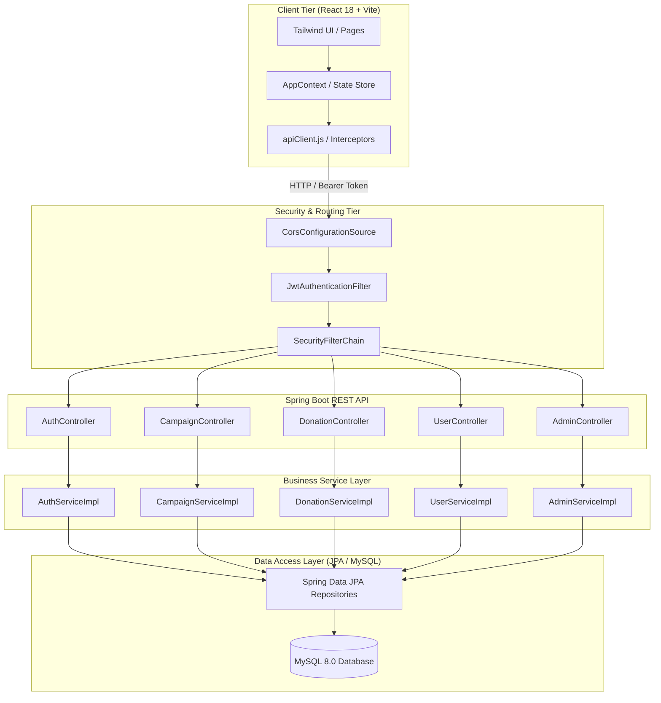

# FundFlow — Community Crowdfunding & Impact Platform

[](https://www.oracle.com/java/)
[](https://spring.io/projects/spring-boot)
[](https://react.dev/)
[](https://vitejs.dev/)
[](https://tailwindcss.com/)
[](https://www.mysql.com/)
[](LICENSE)

> A modern, full-stack crowdfunding and community fundraising web platform engineered with **Spring Boot 3 (Java 21)**, **MySQL 8.0**, and **React 18 (Vite)**. Features real-time campaign discovery, dual-mode API/local resilience, secure JWT authentication, role-based administration, simulated donation tracking, and a fintech-grade responsive design system.

---

## Table of Contents

- [Architectural Overview](#architectural-overview)
- [Key Features](#key-features)
- [Technology Stack](#technology-stack)
- [Directory Structure](#directory-structure)
- [Quick Start Guide](#quick-start-guide)
  - [Prerequisites](#prerequisites)
  - [1. Database Setup](#1-database-setup)
  - [2. Backend Setup](#2-backend-setup)
  - [3. Frontend Setup](#3-frontend-setup)
- [Demo Credentials](#demo-credentials)
- [REST API Reference](#rest-api-reference)
- [Testing & Quality Assurance](#testing--quality-assurance)
- [Deployment Guide](#deployment-guide)
- [Security & Architecture Decisions](#security--architecture-decisions)
- [Academic & Interview Guide](#academic--interview-guide)

---

## Architectural Overview

FundFlow follows a decoupled client-server architecture. The Spring Boot backend exposes a stateless REST API secured via JSON Web Tokens (JJWT 0.12), backed by Hibernate ORM and MySQL 8.0. The React client provides a high-performance single-page application with dual-mode synchronicity—executing live REST operations when connected while providing offline-first demo state persistence.



---

## Key Features

### 1. User & Identity Management
- **Stateless JWT Authentication**: Secure access token issuance (HMAC-SHA256) with Bearer token header propagation.
- **BCrypt Password Hashing**: Passwords salt-hashed before persistence; zero plaintext credentials stored.
- **Role-Based Access Control (RBAC)**: Fine-grained permissions differentiating standard community users (`USER`) from platform administrators (`ADMIN`).
- **Profile Customization**: Live updating of user display names, locations, and personal bios.

### 2. Campaign Management & Discovery
- **Multi-Category Taxonomy**: Filter by Education, Healthcare, Environment, Community, Animal Welfare, and Disaster Relief.
- **Search & Debounced Querying**: Real-time keyword filtering across titles, summaries, and organizer names.
- **Curated Campaign Lifecycle**:
  - `PENDING`: Submitted campaigns enter a moderation review queue.
  - `APPROVED`: Publicly discoverable and eligible for contributions.
  - `REJECTED`: Removed from public listings with organizer visibility.
  - `PAUSED`: Temporarily halted by platform administrators.
- **Live Campaign Wizard**: Step-by-step submission form with real-time preview card, URL validation, and goal constraints.

### 3. Contribution & Impact Engine
- **Preset & Custom Donation Amounts**: Intuitive quick-select buttons (₹250, ₹500, ₹1,000) and custom input in Indian Rupees (₹).
- **Simulated Financial Flow**: Explicit demonstration safeguards ensuring zero unauthorized payment gateway calls while accurately tracking fundraising goals and contributor counts.
- **Audit Logging**: Per-campaign contribution history, recent supporter feeds, and personal donor dashboards.

### 4. Administrative Control Center
- **Review Queue**: One-click approvals and rejections for submitted community causes.
- **User Account Governance**: Ability to toggle account active/disabled states with immediate session enforcement.
- **Platform Analytics**: Aggregate metrics on total capital mobilized, active supporters, and pending reviews.

---

## Technology Stack

| Layer | Technology | Details / Versions |
| :--- | :--- | :--- |
| **Backend Framework** | Spring Boot | 3.4.4 (Java 21 LTS) |
| **Web & Security** | Spring Web, Spring Security | Stateless filter chain, BCrypt, Method security |
| **JWT Library** | Auth0 / io.jsonwebtoken (JJWT) | 0.12.6 (`jjwt-api`, `jjwt-impl`, `jjwt-jackson`) |
| **ORM & Database** | Hibernate 6, Spring Data JPA | MySQL Connector/J 8.0, HikariCP pool |
| **Validation** | Jakarta Bean Validation | `@Valid`, `@NotBlank`, `@Size`, `@Min` annotations |
| **Testing (Backend)** | JUnit 5, MockMvc, AssertJ | 16 automated HTTP integration & service tests |
| **Frontend Framework** | React | 18.3+ with React Router v6 |
| **Build Tool** | Vite | 6.x fast ES module bundler |
| **Styling System** | Tailwind CSS | 3.4 custom tokens, slate/teal fintech palette |
| **Iconography** | Lucide React | Clean, scalable feather-style SVG icons |
| **Testing (Frontend)** | Vitest, Testing Library | 6 automated end-to-end integration assertions |

---

## Directory Structure

```text
FundFlow/
├── backend/
│   ├── src/
│   │   ├── main/
│   │   │   ├── java/com/fundflow/
│   │   │   │   ├── config/         # SecurityConfig, DatabaseSeeder, CORS
│   │   │   │   ├── controller/     # REST Endpoints (Auth, Campaign, Donation, Admin)
│   │   │   │   ├── dto/            # Request & Response Data Transfer Objects
│   │   │   │   ├── entity/         # JPA Entities (User, Campaign, Donation)
│   │   │   │   ├── enums/          # CampaignStatus enum
│   │   │   │   ├── exception/      # GlobalExceptionHandler & custom exceptions
│   │   │   │   ├── repository/     # Spring Data JPA interfaces
│   │   │   │   ├── security/       # JwtService, JwtAuthenticationFilter
│   │   │   │   └── service/        # Service interfaces & business implementations
│   │   │   └── resources/
│   │   │       └── application.yml # Environment-based Spring configuration
│   │   └── test/java/com/fundflow/ # MockMvc & service-level test suites
│   ├── .env.example                # Sample database & JWT environment template
│   └── pom.xml                     # Maven project descriptor
├── frontend/
│   ├── src/
│   │   ├── components/             # Reusable UI controls, cards, layouts, dialogs
│   │   ├── context/                # AppContext (Dual-mode state store & API sync)
│   │   ├── data/                   # Seed data & categories
│   │   ├── hooks/                  # Currency (INR) formatting hooks
│   │   ├── pages/                  # Route views (Home, Explore, Details, Admin, etc.)
│   │   ├── services/               # Axios client, auth & campaign API modules
│   │   ├── App.jsx                 # Routing configuration
│   │   ├── App.test.jsx            # Vitest suite
│   │   └── index.css               # Design system tokens & Tailwind imports
│   ├── index.html                  # HTML5 entrypoint
│   ├── package.json                # Dependencies and npm scripts
│   └── vite.config.js              # Vite bundler configuration
└── README.md                       # Master documentation
```

---

## Quick Start Guide

### Prerequisites
- **Java Development Kit (JDK)**: Version 21 or later.
- **Apache Maven**: Version 3.9 or later (or use `./mvnw`).
- **Node.js**: Version 20 LTS or later with `npm`.
- **MySQL Server**: Version 8.0 or later running on `localhost:3306`.

---

### 1. Database Setup

Log into your local MySQL instance and create the database:

```sql
CREATE DATABASE IF NOT EXISTS fundflow CHARACTER SET utf8mb4 COLLATE utf8mb4_unicode_ci;
```

---

### 2. Backend Setup

1. Navigate to the `backend` folder:
   ```powershell
   cd backend
   ```

2. Configure environment variables. Copy `.env.example` to `.env`:
   ```powershell
   Copy-Item .env.example .env
   ```

3. Ensure the credentials in `.env` match your local MySQL configuration:
   ```ini
   DB_URL=jdbc:mysql://localhost:3306/fundflow?useSSL=false&allowPublicKeyRetrieval=true&serverTimezone=UTC
   DB_USERNAME=root
   DB_PASSWORD=YourPasswordHere
   JWT_SECRET=404E635266556A586E3272357538782F413F4428472B4B6250645367566B5970
   JWT_EXPIRATION=86400000
   PORT=8080
   CORS_ORIGIN=http://localhost:5173
   ```

4. Build and run tests:
   ```powershell
   mvn test
   ```

5. Launch the Spring Boot application:
   ```powershell
   mvn spring-boot:run
   ```
   *Upon startup, `DatabaseSeeder` will automatically populate initial users, campaigns, and donation records if the database is fresh.*

---

### 3. Frontend Setup

1. In a separate terminal, navigate to the `frontend` folder:
   ```powershell
   cd frontend
   ```

2. Install dependencies:
   ```powershell
   npm install
   ```

3. Run the Vitest test suite to confirm setup integrity:
   ```powershell
   npm test
   ```

4. Start the Vite development server:
   ```powershell
   npm run dev
   ```

5. Open your browser and navigate to:
   ```text
   http://localhost:5173
   ```

---

## Demo Credentials

Pre-seeded accounts for testing and demonstration:

| Role | Email Address | Password | Permissions |
| :--- | :--- | :--- | :--- |
| **Platform Admin** | `admin@fundflow.demo` | `admin123` | Full access: review queue, user controls, analytics |
| **Community Member** | `maya@example.com` | `password123` | Campaign organizer, donation history, dashboard |
| **Supporter** | `rohan@example.com` | `password123` | Backer, public discovery, profile settings |

*Alternatively, register any new account directly via the `/register` page.*

---

## REST API Reference

All backend endpoints are prefixed with `/api`.

### Authentication Endpoints (`/api/auth`)

| Method | Endpoint | Access | Description |
| :--- | :--- | :--- | :--- |
| `POST` | `/api/auth/register` | Public | Register user (`name`, `email`, `password`) & return JWT |
| `POST` | `/api/auth/login` | Public | Authenticate user credentials & return JWT |

#### Example: Login Request
```json
POST /api/auth/login
Content-Type: application/json

{
  "email": "admin@fundflow.demo",
  "password": "admin123"
}
```
#### Response (`200 OK`):
```json
{
  "token": "eyJhbGciOiJIUzI1NiJ9...",
  "user": {
    "id": "1",
    "name": "Platform Administrator",
    "email": "admin@fundflow.demo",
    "role": "admin"
  }
}
```

---

### Campaign Endpoints (`/api/campaigns`)

| Method | Endpoint | Access | Description |
| :--- | :--- | :--- | :--- |
| `GET` | `/api/campaigns` | Public | List approved campaigns with optional `category` or `search` |
| `GET` | `/api/campaigns/{id}` | Public | Retrieve detailed information for a single campaign |
| `POST` | `/api/campaigns` | Authenticated | Create a new campaign (defaults to `PENDING` status) |

---

### Donation Endpoints (`/api/donations`)

| Method | Endpoint | Access | Description |
| :--- | :--- | :--- | :--- |
| `POST` | `/api/donations` | Authenticated | Record a simulated donation and update campaign funds |
| `GET` | `/api/donations/my` | Authenticated | Retrieve the authenticated user's donation history |

---

### User & Admin Endpoints (`/api/users` & `/api/admin`)

| Method | Endpoint | Access | Description |
| :--- | :--- | :--- | :--- |
| `GET` | `/api/users/me` | Authenticated | Retrieve current user profile |
| `PUT` | `/api/users/me` | Authenticated | Update user name, location, and bio |
| `GET` | `/api/admin/campaigns` | Admin only | List all campaigns across all statuses |
| `PUT` | `/api/admin/campaigns/{id}/status` | Admin only | Update campaign status (`APPROVED`, `REJECTED`, `PAUSED`) |
| `GET` | `/api/admin/users` | Admin only | List all registered users |
| `PUT` | `/api/admin/users/{id}/enabled` | Admin only | Enable or disable user account |
| `GET` | `/api/admin/donations` | Admin only | Comprehensive platform donation audit log |

---

## Testing & Quality Assurance

FundFlow is built with comprehensive unit, integration, and UI tests across both tiers.

### Backend Test Execution
```powershell
cd backend
mvn test
```
- **16 Automated Tests**:
  - `IntegrationTests.java`: 13 MockMvc tests validating login, registration, duplicate rejection (409), JWT authentication, public retrieval, authorization guards, and admin approval workflows.
  - `FundFlowApplicationTests.java`: Spring Context loading verification with MySQL datasource.
  - `DonationServiceImplTest.java`: Service-layer business logic verification, goal calculations, and reversal semantics.

### Frontend Test Execution
```powershell
cd frontend
npm test
```
- **6 Vitest & React Testing Library Assertions**:
  - Protected route redirection to login.
  - User registration and multi-field campaign creation with validation.
  - Simulated donation recording with immediate state and `localStorage` persistence.
  - Category filtering and search across campaign discovery and homepage.
  - Admin approval workflow.

---

## Deployment Guide

### Option 1: Docker Containerization (Full Stack)

Create a `docker-compose.yml` to launch MySQL, Spring Boot, and Nginx (serving the built frontend):

```yaml
version: '3.8'

services:
  db:
    image: mysql:8.0
    restart: always
    environment:
      MYSQL_DATABASE: fundflow
      MYSQL_ROOT_PASSWORD: rootpassword
    ports:
      - "3306:3306"
    volumes:
      - db_data:/var/lib/mysql

  backend:
    build: ./backend
    restart: always
    ports:
      - "8080:8080"
    environment:
      DB_URL: jdbc:mysql://db:3306/fundflow?useSSL=false&allowPublicKeyRetrieval=true
      DB_USERNAME: root
      DB_PASSWORD: rootpassword
      JWT_SECRET: 404E635266556A586E3272357538782F413F4428472B4B6250645367566B5970
    depends_on:
      - db

  frontend:
    build: ./frontend
    restart: always
    ports:
      - "80:80"
    depends_on:
      - backend

volumes:
  db_data:
```

### Option 2: Cloud Deployment (PaaS)
1. **Frontend**: Deploy `frontend/dist` (built via `npm run build`) to **Vercel**, **Netlify**, or **AWS S3 + CloudFront**. Set `VITE_API_URL=https://your-api-domain.com/api`.
2. **Backend**: Package jar with `mvn package` and deploy to **Render**, **Railway**, or **AWS Elastic Beanstalk**. Set environment variables `DB_URL`, `DB_USERNAME`, `DB_PASSWORD`, `JWT_SECRET`, and `CORS_ORIGIN`.
3. **Database**: Provision a managed **AWS RDS MySQL** or **PlanetScale** database.

---

## Security & Architecture Decisions

1. **Stateless JWT vs. Stateful HTTP Sessions**:
   - Eliminates server-side session affinity; enables horizontal scaling across multiple container instances.
   - JWT validated on every request via `JwtAuthenticationFilter` before execution reaches controller handlers.

2. **Dual-Mode Frontend Architecture**:
   - `AppContext` performs immediate synchronous state updates (guaranteeing instant UI responsiveness and offline Vitest execution) while transparently synchronizing with the backend REST endpoints.
   - Graceful fallback ensures recruiters can review the application locally even if MySQL is temporarily offline.

3. **Defensive Input Validation**:
   - Controller boundaries enforce `@Valid` annotations with Jakarta Bean Validation (`@NotBlank`, `@Min`, `@Size`).
   - `GlobalExceptionHandler` formats validation failures into clear, RFC-compliant error structures with field-specific diagnostics.

4. **Honest Fintech Communication**:
   - All donation flows explicitly communicate their simulated demonstration status.
   - Currency formatting uses standard Indian Rupee notation (`₹`, `en-IN`, `tabular-nums`) for readability.

---

## Academic & Interview Guide

### Common Viva & Technical Interview Questions

**Q1: How is authentication and role-based access control secured in this application?**  
> *Answer*: Authentication is implemented using Spring Security 6 with stateless session management. Upon valid credentials, `JwtService` issues an HMAC-SHA256 signed JWT containing the user's email and role claims. For subsequent requests, `JwtAuthenticationFilter` intercepts the `Authorization: Bearer <token>` header, parses the claims, and populates the `SecurityContextHolder`. Protected administrative endpoints are guarded using `hasRole('ADMIN')`.

**Q2: How does the platform prevent duplicate donation or concurrency issues when updating raised amounts?**  
> *Answer*: The `DonationServiceImpl` executes within `@Transactional` boundaries. When a donation is recorded, the corresponding `Campaign` entity is fetched, its `raised` amount and backer count incremented, and saved in an atomic transaction, ensuring data integrity.

**Q3: How are passwords stored securely?**  
> *Answer*: Passwords are encrypted using Spring Security's `BCryptPasswordEncoder`, which uses a random 16-byte salt and iterative key derivation (default cost factor of 10) to protect against rainbow table and brute-force attacks.

**Q4: What makes the frontend design system suitable for a fintech application?**  
> *Answer*: Rather than relying on generic, over-animated templates, FundFlow employs a disciplined design system: slate neutral backgrounds (`#f8fafc`), deep readable text (`#0f172a`), a single restrained brand accent (`#0f766e`), consistent 8px/16px/24px spacing, tabular numerals for currency (`font-variant-numeric: tabular-nums`), accessible form labels with `aria-describedby` error associations, and mobile-responsive layouts.

---

## License

This project is licensed under the MIT License — see the [LICENSE](LICENSE) file for details.
